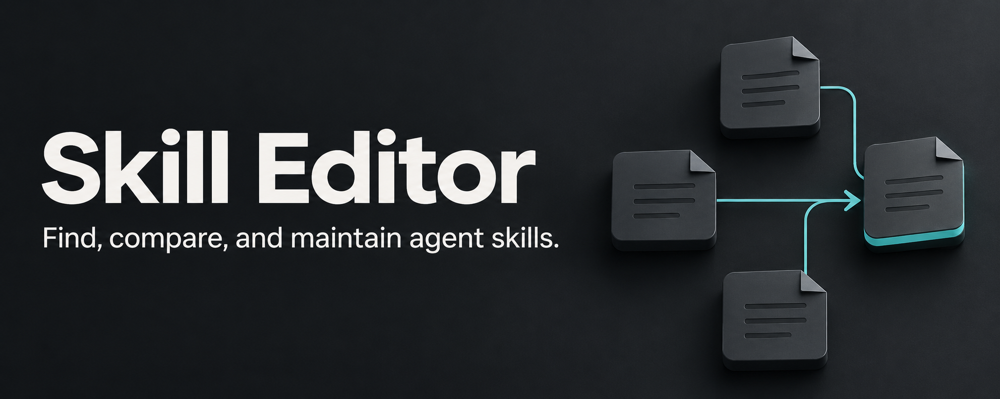

[English](README.md) · [简体中文](README.zh-CN.md)



Skill Editor is a local workspace for choosing, comparing, and maintaining Agent Skills. Browse your library, inspect what overlaps, and prepare a specific version for the Agent you use.

[Download the current source ZIP](skill-editor-agent-workbench-2026-11-09.zip)

## What you can do today

| Need | What Skill Editor does |
| --- | --- |
| Find a skill | Browse your local library and the curated catalog, or search public sources. Start from a task to see suggested skills and gaps. |
| Understand overlap | Compare instructions and inspect cited evidence for scope overlap, delegation, complementary roles, or conditional conflicts. Automated checks flag signals such as matching names and descriptions. |
| Add or update a skill | Check directory evidence for Codex, Claude Code, Cursor, and OpenCode. Preview an exact version and its destination, then use version backups to recover a previous managed installation. |

The relationship view includes reviewed evidence and static checks. Choosing which skill to keep still requires review. A scan can show additions and changes since a previous scan. The original install date of existing skills may be unknown, while installs managed by the app record timestamps internally.

## What we verified

The November 9, 2026 release passed 258 backend and 33 frontend checks. Desktop and mobile checks covered Agent selection, local search, previews, and preflight. An isolated run installed version A, updated to B, and restored A.

That establishes the file delivery workflow. Real Agent activation, task quality gains, and model compatibility still need task-level evidence. Community ratings and discussions are proposed features.

## Run locally

Use Python 3.9+, Node.js 22.12+, and npm. Download and unzip the current source package above. The expanded repository directories on `main` are an earlier snapshot.

```sh
cd prototypes/skill-flow
npm ci
npm run build
cd ../..
python3 -m skill_editor.server --port 8766
```

Open [the workspace](http://127.0.0.1:8766/). To create your local index, open [Maintenance](http://127.0.0.1:8766/maintenance/) and choose the rescan action. In Maintenance, open **Relationships** or select two skills to compare their evidence. Your library and task history are stored locally.
