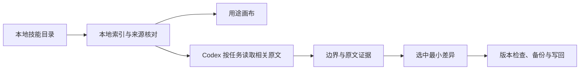

# Skill Engine

理解、选择和稳妥维护个人 Agent Skills 的本地交互工作台。

技能越来越多以后，困难在于：不知道自己已有何种能力、相近技能何时该选哪个，以及修改触发描述时会不会破坏原意。Skill Engine 将本地原文、用途地图、任务讨论和可审阅修改连接起来。

项目包含三部分：

- `skills/skill-engine/`：安装到 Codex 的对话技能，按当前任务解释候选和边界。
- `skill_editor/` 与 `web/`：Python 标准库后端、现有无构建编辑器。
- `prototypes/skill-flow/`：自行设计的 React Flow 深色地图原型；先看分类，再展开卡片和证据。

## 安装和使用

这是私有开发仓库，下载者需要相应 GitHub 访问权限。

```sh
git clone https://github.com/ArthurQQQQ/skill-engine.git
cd skill-engine
```

安装对话技能时，将完整的 `skills/skill-engine` 目录放入当前 Codex 使用的技能目录。当前官方用户目录是 `~/.agents/skills/`，项目目录是 `.agents/skills/`；旧安装可能仍使用 `~/.codex/skills/`。先检查实际安装位置，已有同名技能时先比较，不覆盖。也可以让 `$skill-installer` 从本仓库的 `skills/skill-engine` 安装；私有仓库仍需要可用认证。安装后检查当前会话目录；未出现时重新开启会话或重启 Codex。[官方安装与发现说明](https://learn.chatgpt.com/docs/build-skills)

然后在 Codex 中说：

> `$skill-engine` 帮我看看本地有什么技能，这个任务适合用哪个？

安装 skill 提供的是对话工作流，不会自动启动网页、扫描整盘或上传本地技能。

## 将本地 skills 放进地图

这里的“导入”是连接本地目录并建立索引，原始技能留在原处。首次使用没有附带个人盘点。

当前默认扫描器读取 `~/.codex/skills` 和 `~/.codex/plugins/cache`：

```sh
python3 -m skill_editor.server --port 8766
```

打开 `http://127.0.0.1:8766/`，点击顶栏“重新扫描技能文件”。这才会发现新成员。地图里的“重读”仅重新读取已盘点成员。

如果你的技能位于 `~/.agents/skills` 或其他目录，当前 CLI 尚无目录选择参数，需要用现有 Python 构造接口指定同一根目录启动服务。完整步骤见 [安装和本地导入](docs/INSTALL-AND-IMPORT.md)。不要把官方目录与本项目旧默认值混为一谈。

## React Flow 体验页

需要 Node 满足 `prototypes/skill-flow/package.json` 的 engines，构建前遵守当前用户的计算执行授权：

```sh
cd prototypes/skill-flow
npm ci
npm run build
```

由仓库根目录的同一个 Python 服务提供 `http://127.0.0.1:8766/flow-lab/index.html`。首次先在主编辑器显式扫描，然后回到体验页重读。独立原型采用免费 React Flow 库，未复制官方付费模板；尚未迁移为主编辑器。

## 技术核心



画布解决浏览问题；核心逻辑是来源身份、按任务辨认边界、带证据的最小修改，以及版本保护。项目没有自研模型，也没有替换 Codex 的原生技能选择引擎。真正的效果需要未来用实际任务和真实选择回放验证，不能从连线或引文匹配推断。

普通浏览和 Codex 对话不需要额外模型 API。网页可选模型分析仅使用 OpenRouter，凭据和模型名来自进程配置；不会直连或回退到 OpenAI API。

## 当前边界

- 支持显式本地目录索引；尚无任意文件夹选择、ZIP 安装或通用一键 onboarding。
- 磁盘存在、插件缓存和当前会话可调用是不同状态。新发现的插件缓存单列统计，不自动成为当前会话技能。
- 关系有类型、条件和引文；不是实际执行图。用途分类是编辑器标注，未知技能归入待整理类别。
- 修改仅限用户明确选择的个人技能 description，检查 SHA、保留备份和其他内容；系统与插件只读。
- 网页“交给 Codex”生成可复制提示，没有向当前聊天自动发送的桥接。
- 后端使用 Unix 文件接口，主要面向 macOS/Linux；尚未验证完整 Windows 支持。

仓库只含应用源码和通用文档。本地索引、技能全文快照、独立意图、案例、备份、凭据和历史记录不随代码提交。见 [架构与研发方向](docs/ARCHITECTURE.md) 和 [验证范围](docs/VALIDATION.md)。
