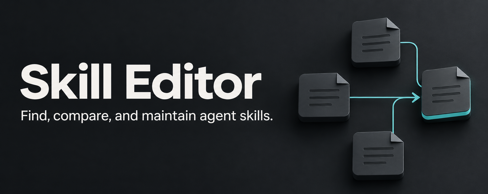

[English](README.md) · [简体中文](README.zh-CN.md)



Skill Editor 是一个本地 Agent 技能工作台。你可以查找、比较和维护技能，了解哪些用途有重叠，再把选好的版本交付给指定 Agent。

[下载当前完整源码 ZIP](skill-editor-agent-workbench-2026-11-09.zip)

## 现在能做什么

| 需求 | Skill Editor 提供的能力 |
| --- | --- |
| 找到适合的技能 | 浏览本地库、精选目录和公开来源。按任务查看推荐组合与缺口。 |
| 看懂技能之间的关系 | 对照技能原文和引文，查看用途重叠、委派、互补或条件性冲突。自动规则提示同名、相同描述等线索。 |
| 安装或更新 | 查看 Codex、Claude Code、Cursor、OpenCode 的目录证据。预览具体版本与目标目录，必要时从应用管理的历史版本恢复。 |

关系页显示经过审阅的证据和静态规则检查。保留哪项仍需人工判断。扫描可以看到较上一次盘点有哪些新增或变化。外部技能的初次安装时间可能未知，应用管理的安装在内部保存时间和版本记录。

## 已验证的使用效果

2026 年 11 月 9 日版通过 258 项后端和 33 项前端检查。桌面和手机均检查了 Agent 选择、本地搜索、版本预览和安装预检。隔离环境走通了安装 A、更新 B、恢复 A。

验证覆盖文件交付与恢复。真实 Agent 触发、任务质量提升和模型兼容性仍需实测。社区评分和讨论属于拟议功能。

## 本机运行

需要 Python 3.9+、Node.js 22.12+ 和 npm。请下载并解压上面的当前源码包，`main` 下展开的源码目录是较早快照。

```sh
cd prototypes/skill-flow
npm ci
npm run build
cd ../..
python3 -m skill_editor.server --port 8766
```

打开 [本地工作台](http://127.0.0.1:8766/)。首次使用，到 [高级维护](http://127.0.0.1:8766/maintenance/) 点击重新扫描。进入「关系」或选中两项比较，可查看原文证据。本地技能库和任务记录保存在本机。
